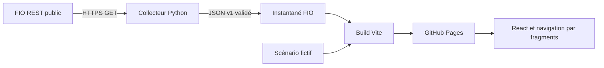

# Architecture M0

| Module | Responsabilité |
| --- | --- |
| `collector/collect.py` | Transport, délais, reprises HTTP et publication atomique |
| `collector/normalize.py` | Adaptation FIO, typage des champs, unicité et intégrité des références |
| `src/data.ts` | Contrat JSON v1 et chargement de l’instantané issu de Pages |
| `src/domain.ts` | Calculs, fraîcheur, recherche et formatage |
| `src/pages/` | Vues Tableau de bord, Marchés, Matériaux et Production |
| `data/demo.json` | Scénario fictif intégré au bundle, sélection explicite |
| `public/data/fio.json` | Instantané de départ réel. Actions le régénère dans l’artefact publié |

Les jointures utilisent le ticker matériau, le code bourse et le ticker bâtiment. Une cotation est identifiée par le couple bourse-matériau, et une recette par `StandardRecipeName`. Chaque ordre public est représenté par son prix unitaire et sa quantité éventuellement nulle. Le contrat distingue `collectedAt` (fin de la collecte), `observedAt` (horodatage fourni par FIO pour la cotation) et `lastTradeAtMs` (dernière transaction).

Le navigateur charge un fichier du même site. Le changement de page utilise les fragments d’URL et conserve un point d’entrée commun sur un sous-chemin de projet. Une panne de rechargement dans l’onglet conserve le dernier instantané validé en mémoire avec un message visible. Une panne de collecte dans Actions interrompt le déploiement et la dernière version Pages reste en ligne avec ses dates d’origine.
